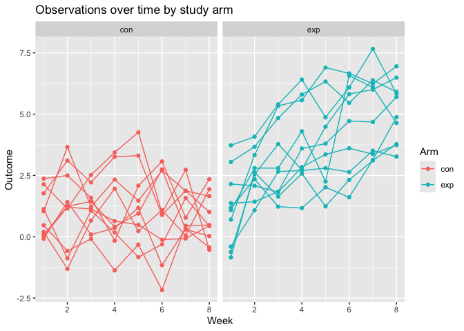
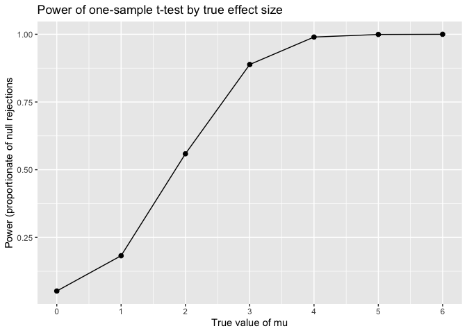
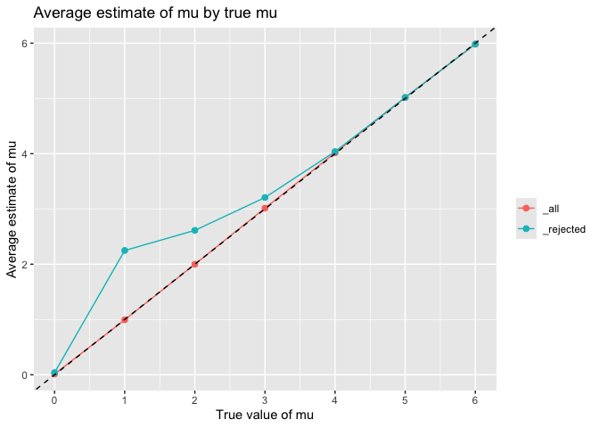

p8105_hw5_di2251
================
di2251
2026-11-18

### Problem 2

Read in files:

``` r
csv_data = 
  tibble(
    files = list.files(path = "data/data/"),
    path = str_c("data/data/", files)
  ) |>
  mutate(data = map(path, read_csv)) |>
  unnest(data)
```

Tidy data:

``` r
data_tidy =
  csv_data |>
  mutate(
    files = str_replace(files, ".csv", ""),
    exp_arm = str_sub(files, 1, 3),
    sub_ID = str_sub(files, 5,6) 
  ) |>
  pivot_longer(
    week_1:week_8,
    names_to = "week",
    values_to = "outcome",
    names_prefix = "week_"
  ) |>
  mutate(week = as.numeric(week)) |>
  select(exp_arm, sub_ID, subject = files, week, outcome)
```

Create spaghetti plot:

``` r
data_tidy |>
  ggplot(aes(x = week, y = outcome, group = subject, color = exp_arm)) +
  geom_point() +
  geom_path() +
  facet_grid(~exp_arm) +
  labs(
    title = "Observations over time by study arm",
    x = "Week",
    y = "Outcome",
    color = "Arm"
  )
```

<!-- -->
This plot demonstrates a clear difference between the two arms in how
outcomes change over time. In the control arm, outcomes show no
consistent trend. Most subjects fluctuate between about -1 and 4 across
the 8 weeks, and the weekly movement appears random rather than in any
discernible pattern. Lines cross frequently, so there is little evidence
that subjects stay consistently above or below average. Subjects in the
experiential arm, display a steady, roughly linear increase. Most start
between about -1 and 3.5 at week 1 and end between about 3 and 7 at week
8. the experimental arm also spreads out over time, with more
variability between subjects at later weeks, suggesting that individuals
respond at different rates.

### Problem 3

Write function for one dataset:

``` r
sim_t_test = function(mu, n = 30, sigma = 5) {
  x = rnorm(n, mean = mu, sd = sigma)
  
  t.test(x, mu = 0) |>
    broom::tidy() |>
    select(estimate, p.value)
}
```

Run 5000 datasets for mu = 0:

``` r
sim_mu_0 = 
  tibble(iter = 1:5000) |>
  mutate(results = map(iter, \(i) sim_t_test(mu = 0))) |>
  unnest(results)
```

Repeat for mu = 0, 1, 2, 3, 4, 5, 6:

``` r
sim_results = 
  expand_grid(
    mu = 0:6,
    iter = 1:5000
  ) |>
  mutate(results = map(mu, \(m) sim_t_test(mu = m))) |>
  unnest(results)
```

Flag rejections:

``` r
sim_results = 
  sim_results |>
  mutate(reject = p.value < 0.05)
```

Plot 1, power vs true mu

``` r
power_df = 
  sim_results |>
  group_by(mu) |>
  summarize(power = mean(reject))

power_df
```

    ## # A tibble: 7 × 2
    ##      mu power
    ##   <int> <dbl>
    ## 1     0 0.052
    ## 2     1 0.182
    ## 3     2 0.559
    ## 4     3 0.888
    ## 5     4 0.990
    ## 6     5 0.999
    ## 7     6 1

``` r
power_df |>
  ggplot(aes(x = mu, y = power)) +
  geom_line() + 
  geom_point(size = 2) +
  scale_x_continuous(breaks = 0:6) +
  labs(
    title = "Power of one-sample t-test by true effect size",
    x = "True value of mu",
    y = "Power (proportionate of null rejections"
  )
```

<!-- -->

Power increases as the true effect size increases. When mu is 0, the
null is true, so the rejection rate is about 0.05. Power rises steeply
from mu = 1 to approximately mu = 3 and levels off near 1 by mu = 5.

Plot 2, average estimate vs true mu

``` r
est_df =
  sim_results |>
  group_by(mu) |>
  summarize(
    avg_est_all = mean(estimate),
    avg_est_rejected = mean(estimate[reject])
  ) |>
  pivot_longer(
    starts_with("avg_est"),
    names_to = "sample_type",
    names_prefix = "avg_est",
    values_to = "avg_estimate"
  ) |>
  mutate(
    sample_type = recode(sample_type,
                         all = "All samples",
                         rejected = "Null rejected only")
  )

est_df
```

    ## # A tibble: 14 × 3
    ##       mu sample_type avg_estimate
    ##    <int> <chr>              <dbl>
    ##  1     0 _all              0.0127
    ##  2     0 _rejected         0.0396
    ##  3     1 _all              0.993 
    ##  4     1 _rejected         2.25  
    ##  5     2 _all              2.00  
    ##  6     2 _rejected         2.61  
    ##  7     3 _all              3.01  
    ##  8     3 _rejected         3.21  
    ##  9     4 _all              4.01  
    ## 10     4 _rejected         4.04  
    ## 11     5 _all              5.02  
    ## 12     5 _rejected         5.02  
    ## 13     6 _all              5.98  
    ## 14     6 _rejected         5.98

``` r
est_df |>
  ggplot(aes(x = mu, y = avg_estimate, color = sample_type)) +
  geom_line() +
  geom_point(size = 2) +
  geom_abline(slope = 1, intercept = 0, linetype = "dashed") +
  scale_x_continuous(breaks = 0:6) +
  labs(
    title = "Average estimate of mu by true mu",
    x = "True value of mu",
    y = "Average estimate of mu",
    color = ""
  )
```

<!-- -->

The sample average of mu among rejected tests is not equal for smaller
true mu values and approximately equal for larger true mu values. For
the small true mu values (such as 1 or 2), the average my is noticeably
larger than the true value. When mu = 0, the average is also near 0. As
mu grows and power approaches 1, the rejected-sample average converges
to the true mu. This is because with low power, a sample only reaches p
\< 0.05 when its sample mean is far from 0, so conditioning on rejection
only fails to eliminate larger estimates. When the power is near 1,
nearly every sample is rejected, so there is almost no selection.
